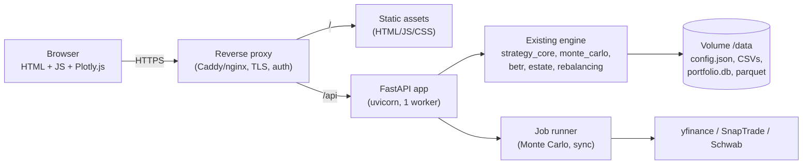

# Plan: Streamlit → HTML Front End + Containerized Deployment

## 1. Current State (from code inspection)

| Item | Finding |
|---|---|
| UI framework | Streamlit multi-page app; entry [`planning_app.py`](../planning_app.py) redirects to `pages/3_dashboard.py` |
| Pages | 10 active pages in `pages/` (largest: `2_configuration.py` ~6.2k LOC, `5_strategy.py` ~4.6k LOC, `1_estate_planning.py` ~1.9k LOC) |
| Files importing Streamlit | 46 (all pages, ~25 `components/*`, plus `load_data.py`, `config.py`, `portfolio.py`, `income_expense.py`, `ssibenefits.py`, `tax_harvesting.py`, `portfolio_analytics.py`, `editable_table.py`, `calculations.py`, `portfolio_data_entry.py`) |
| Pure-Python engine (no Streamlit) | ~57k LOC: `strategy.py`, `strategy_core/**`, `monte_carlo.py`, `betr_roth_conversion.py`, `advanced_strategies.py`, `bucket_strategy.py`, `estate_tax_calculations.py`, `portfolio_rebalancing.py`, `portfolio_db.py`, brokerage connectors, `components/reporting/pdf_generator.py` |
| Heavily used Streamlit features | `st.markdown` (~850), `st.metric` (~270), `st.columns` (~265), `st.number_input` (~200), `st.session_state` (~180+), `st.rerun` (~80), `st.data_editor` / `st.dataframe` (~65), `st.plotly_chart` (~48), `st.download_button` (~39), `st.cache_data` (~29), `st.tabs` (~23) |
| Persistence | Flat files in repo root (`retirement_config.json`, `portfolio_data_truth.csv`, tax CSVs), SQLite (`portfolio.db`, WAL mode; credential store, rebalancing cache), Parquet caches, `.backups/` |
| Background work | `components/sync_scheduler.py` runs a daemon thread (brokerage sync) |
| External integrations | yfinance, SnapTrade, Schwab OAuth (callback `https://localhost:8080/callback`) |
| Tests | 90 files, ~25k LOC; CI runs pytest on Python 3.11/3.13 |
| Existing deployment | `run.sh` / `run.bat` only. No Dockerfile, no auth (single local user). |

**Key insight:** roughly half the code (the financial engine) is already UI-independent. The migration cost is concentrated in ~17k+ lines of page code and in the ~10 "core" modules that mix Streamlit calls (`st.cache_data`, `st.session_state`, `st.error`) into data/logic.

## 2. Decision Required: What does "HTML" mean?

| Option | Description | Effort | Verdict |
|---|---|---|---|
| **A. HTML/JS front end + Python API (FastAPI)** | Browser UI talks to a Python backend that reuses the existing engine | Medium–High | **Recommended** |
| B. Server-rendered HTML (FastAPI + Jinja2 + HTMX) | Python renders HTML fragments; minimal JS | Medium | Good fallback if you want little JavaScript |
| C. Fully static HTML + JS (no backend) | Rewrite engine in JS or run Python via Pyodide in-browser | Very High | Not recommended: 57k LOC of tax/withdrawal logic would need porting/re-validation; Pyodide + pandas/yfinance/cryptography/reportlab is heavy and brokerage secrets would live in the browser |

**Recommendation: Option A**, with Plotly.js for charts (the app already produces Plotly figures, so figures can be serialized with `fig.to_json()` and rendered unchanged) and a lightweight, **no-build-step** front-end stack: Alpine.js + Plotly.js + Tabulator (confirmed, see section 8).

> **Decision (confirmed): Option A.** See "Confirmed Decisions" in section 8 for the other choices and how they shape each phase.

## 3. Target Architecture



Proposed layout:

```
app/
  api/            # FastAPI routers: config, portfolio, strategy, monte_carlo, advanced, estate, scenarios, reports, admin
  services/       # Thin orchestration over existing engine modules
  core/           # (moved/refactored) UI-free data access: settings, config store, cache
  web/            # index.html, per-page HTML/JS modules, css, vendored plotly.min.js
Dockerfile            # name kept for tool compatibility; built with `podman build`
compose.yaml
```

Existing engine modules stay where they are initially (import path stability) and are moved later only if desired.

## 4. Phased Plan

### Phase 0 – Decisions & Safety Net (1–2 days)
- Decisions are confirmed (section 8). Remaining task: define **Streamlit/HTML coexistence rules**, because both UIs will share data:
  - Both UIs read/write the same files via the one shared `ConfigStore`/`DATA_DIR` layer (atomic writes + file lock + existing timestamped backups), so edits in one are visible in the other.
  - Only one process owns background work: the sync scheduler runs in the FastAPI service; the Streamlit service sets `DISABLE_SCHEDULER=1`.
  - No schema/config changes that the Streamlit version can't read; any new config fields must have defaults and be optional.
  - Streamlit remains in `requirements.txt` (or a `requirements-legacy.txt` layered in the image) and its tests stay in CI.
- Capture **golden-master outputs** from the current app for regression: run `strategy`, Monte Carlo (fixed seed), BETR, estate calcs against `retirement_config.json.example` / `example1–4_*.csv` and snapshot results to JSON. These become API contract tests.
- Run the existing test suite and record baseline coverage (CI gate is 50%).
- Inventory of every Streamlit widget → API field mapping (generated by grepping `st.number_input/selectbox/...` per page).

### Phase 1 – Decouple the Engine from Streamlit (≈1–2 weeks) — *highest-risk, highest-value*
Goal: no non-UI module imports `streamlit`.
1. Replace `st.cache_data` in `load_data.py` (18 uses), `portfolio.py`, `tax_harvesting.py`, `portfolio_analytics.py` with `functools.lru_cache` / a small TTL cache with explicit invalidation (replacing `st.cache_data.clear()`; 5 call sites).
2. Replace `st.session_state` used as global state in `config.py`, `load_data.py`, `income_expense.py`, `ssibenefits.py`, `portfolio.py` with an explicit `ConfigStore` / request-scoped context object (config JSON + file lock; there is currently no multi-process safety).
3. Replace `st.error/warning/info` in logic modules with exceptions/`logging`; surface to UI as HTTP error payloads.
4. Split mixed modules into `*_logic` (pure) and `*_ui` (Streamlit) parts; e.g. `portfolio_data_entry.py`, `editable_table.py`, `calculations.py` (imports Streamlit but has no `st.` calls — trivial to clean).
5. Introduce a `settings.py` with `DATA_DIR` (env var, default repo root) so all file/DB paths (`retirement_config.json`, CSVs, `portfolio.db`, parquet caches, `.backups/`, `withdrawal_strategy_output.csv`) are resolved from one place. Currently these are cwd-relative, which is the main blocker for containerization.
6. Make `sync_scheduler` start from FastAPI lifespan rather than `st.session_state`.
- **Exit criteria:** `grep -r "import streamlit"` returns only `pages/`, UI components, and Streamlit-only files; existing Streamlit app still works; pytest green.

### Phase 2 – API Layer (≈2 weeks)
- FastAPI app with Pydantic models derived from `retirement_config.json` schema (`/api/config` GET/PUT with the existing backup behavior).
- Endpoints by domain (migrate in this order, mirroring page value/complexity):
  1. Config + reference data (tax CSVs, admin/tax data page)
  2. Dashboard (net worth, readiness, market trend indicators)
  3. Strategy (year-by-year plan) — returns DataFrame as JSON records + column metadata
  4. Monte Carlo — **async job** (`POST /api/monte-carlo` → job id, `GET /api/jobs/{id}`, progress via SSE) since 10,000 runs would block a request
  5. Portfolio Hub (holdings CRUD, analytics, rebalancing, harvest, direct indexing, brokerage sync)
  6. Advanced strategies (BETR, bucket, SS optimization, DAF/mega backdoor)
  7. Estate planning, Scenario planning, Reports (PDF via existing `pdf_generator.py`, returned as file download)
- Plotly figures: return `fig.to_plotly_json()`; render with Plotly.js.
- Keep API OpenAPI docs enabled (useful as the contract with the front end).
- **Single uvicorn worker** initially (SQLite WAL + scheduler thread + file-based config); use a background thread pool / process pool for CPU-bound Monte Carlo.

### Phase 3 – HTML Front End (≈3–4 weeks, parallelizable per page)
- App shell: top nav (replaces `streamlit-option-menu`/`navbar.py`), sidebar (replaces `components/sidebar.py`), theme (replaces `.streamlit/config.toml` and `components/theme.py`).
- Reusable UI primitives replacing Streamlit idioms: metric card, tabs, expander, form field (number/select/slider/date/color), editable table (replace `st.data_editor` with Tabulator), toast/alert, spinner/progress, download button, modal (replaces `st.dialog`/`harvest_review_modal`).
- Client-side state store replaces `st.session_state`; server remains source of truth for persisted data. The ~80 `st.rerun()` patterns become explicit re-fetch/re-render.
- Port pages in this order: Dashboard → Configuration (largest; split into tabs/sub-routes) → Strategy → Monte Carlo → Portfolio Hub → Advanced → Estate → Scenarios → Reports → Admin.
- Static assets (Plotly.js, fonts) **vendored**, not CDN, to keep the "no data leaves your machine" promise and allow offline use.
- Accessibility and responsive layout pass; disable external requests.

### Phase 4 – Security & Brokerage Flows (≈1 week; overlaps Phase 2/3)
- **Authentication (single user, local):** no multi-user accounts needed. Publish the container port on `127.0.0.1` only (`127.0.0.1:8000:8000`), so nothing else on the LAN can reach it. Optionally add a single-user passcode (FastAPI session login) as an opt-in setting for shared machines. If the user later exposes it beyond localhost, a passcode and TLS become mandatory. Data is highly sensitive (net worth, planning data).
- **Secrets:** `.env` is already used by `python-dotenv`; in containers use `env_file` (or Podman secrets) that is *not* baked into the image. Note `.env.example` contains a populated-looking `ENCRYPTION_KEY` — replace with a placeholder and rotate if that value was ever real.
- **Brokerage sync from day one (SnapTrade + Schwab) in the container:**
  - **M1 finding (verified in code):** the current Schwab flow is *paste-the-callback-URL* (`components/schwab_ui.py`): after authorizing, the browser's redirect to the registered https callback is allowed to fail to load, and the user pastes the URL from the address bar into the app. That works unchanged in the container, so no TLS listener is needed for M1. The listener below is only needed for the HTML version if a seamless redirect is wanted.
  - Schwab requires an **https** callback. Keep the registered URL `https://localhost:8080/callback` (no re-registration needed) and serve it from the container: either publish a TLS listener on host port 8080 (self-signed or `mkcert`-generated local cert, mounted as a volume), or run a tiny TLS-terminating proxy service in compose. Implement a real `/api/schwab/callback` route and make `SCHWAB_CALLBACK_URL` configurable.
  - Token persistence: Schwab tokens and SnapTrade credentials (encrypted by `credential_manager.py` in SQLite) must live on the `/data` volume so they survive container restarts and image upgrades. `ENCRYPTION_KEY` comes from `.env`/secret and must be stable across rebuilds.
  - SnapTrade connection-portal redirect: make the redirect URL configurable and point it at `http(s)://localhost:<port>`.
  - Outbound internet access is required (yfinance, SnapTrade, Schwab); do not use an internal-only container network.
  - The sync scheduler (daemon thread) starts in the FastAPI lifespan; the Streamlit process must not run its own scheduler against the same DB at the same time (see coexistence rules in Phase 0).
- CSRF protection, strict CORS (same-origin), security headers (CSP without external origins), input validation via Pydantic, file-upload size/type limits (CSV import).
- Remove `.backups/`, DB files, CSV snapshots, `.env` from images via `.dockerignore`.

### Phase 5 – Containerization (≈3–5 days; start a skeleton in Phase 2)
Deliverables:
- **`Dockerfile`** (multi-stage): `python:3.11-slim`; build stage creates a wheel cache from a split `requirements-prod.txt` (move `pytest*`, and likely `kaleido`, `streamlit*` to dev/legacy files); runtime stage runs as **non-root** user, `PYTHONDONTWRITEBYTECODE=1`, `HEALTHCHECK` on `/api/health`, `CMD uvicorn app.main:app --host 0.0.0.0 --port 8000 --workers 1`.
  - System packages: confirm needs for `graphviz` (binary), `matplotlib` fonts, `reportlab`; add only what's required.
- **`compose.yaml`** (Compose spec; runs under `podman compose`, also valid for `docker compose`): services `web` (FastAPI + static HTML, port `127.0.0.1:8000`) and `streamlit` (legacy UI, port `127.0.0.1:8501`, behind a compose **profile** so it runs only when requested); optional `tls-proxy` for the Schwab https callback; a **named volume** `retirement_data:/data` shared by both with `DATA_DIR=/data`; `env_file: .env`; `restart: unless-stopped`; `tmpfs` for `/tmp`.
- **Podman specifics (confirmed runtime: Podman on macOS/Windows via `podman machine`; verified on the dev laptop: Podman 6.1.4, `applehv` VM, arm64, 4 CPUs, **rootful** machine, `podman-compose` 1.6.0):**
  - **Verified setup facts (dev laptop):** (1) `podman machine` had to be stopped and started once to recover from a stuck "Currently starting" state; (2) two Podman installs exist (`/opt/homebrew/bin/podman` and `/opt/podman/bin/podman`, both resolve to 6.1.4) so launchers should call `podman` from `PATH` and not hard-code a path; (3) the Docker API socket is held by Rancher Desktop, so Podman exposes its own socket and the Docker-compat socket is not claimed; never rely on `DOCKER_HOST` defaults; (4) **`podman compose` defaults to Rancher's `docker-compose`** when it is on `PATH`, so the launchers must set `PODMAN_COMPOSE_PROVIDER=podman-compose` (and `PODMAN_COMPOSE_WARNING_LOGS=false`) explicitly. A throwaway compose file with a `profiles:` service was run under `podman-compose` 1.6.0 and profiles were honoured.
  - **Engine:** use `podman compose` (a thin wrapper that delegates to `podman-compose` or `docker-compose` — **`podman-compose` is the chosen provider**, installed on the dev laptop and listed in `requirements.txt` under "Container tooling") and `podman build`. It is a host-side tool: when `requirements-prod.txt` is split out (Phase 5) it belongs in the dev/tooling file and must stay out of the container image. Keep the file named `Dockerfile` (Podman reads it) so CI and other engines work unchanged. Avoid Docker-only features (BuildKit-only syntax such as `RUN --mount` cache mounts, `docker-compose` v1 keys); compose **profiles** are honoured by `podman-compose` 1.6.0 (verified).
  - **Volume ownership:** the dev machine is *rootful* (`podman info` reports `rootless=false`), but other users' machines (default `podman machine init`) are often rootless. The compose file must work in both: the container runs as a non-root user, and rootless Podman remaps UIDs, so a fresh named volume can be unwritable. Use `userns_mode: keep-id` or the `:U` volume option in compose, and `chown` the data directory in the entrypoint; test first-run seeding and SQLite writes explicitly.
  - **HEALTHCHECK:** Podman builds OCI images by default, which drops a Dockerfile `HEALTHCHECK`. Declare the `healthcheck:` in `compose.yaml` instead (or build with `--format docker`).
  - **Restart policy:** `restart: unless-stopped` works only while the Podman machine VM is running. The VM does not start on login by default; the launcher scripts must run `podman machine start` if it is stopped (and wait until it is ready).
  - **Ports:** rootless cannot bind host ports below 1024; 8000, 8080 and 8501 are fine. Keep the `127.0.0.1:` prefix on every published port.
  - **Host access from the container:** use `host.containers.internal` (not `host.docker.internal`) if the container ever needs to reach a host service.
  - **Machine sizing:** the existing machine is 4 CPUs / ~7.5 GB RAM / 93 GB disk, which is adequate for Monte Carlo; document `podman machine set --cpus/--memory` for others.
  - **Multi-arch:** local builds are native (arm64 on Apple Silicon). For publishing amd64+arm64, use `podman build --platform linux/amd64,linux/arm64 --manifest …` (QEMU emulation) or CI.
  - **Other engines on this laptop:** Rancher Desktop (`~/.rd/bin/docker`, `docker-compose`) is also installed and owns the default Docker socket. The launchers should detect the engine explicitly (prefer `podman`, fall back to `docker`) and pin the compose provider as above, so the wrong daemon is never used silently; do not run both engines against the same volume.
  - **Windows:** Podman runs through a WSL2-based `podman machine` (Podman Desktop is optional). `start.ps1` must handle the same machine-start logic.
- **Mac and Windows (Podman machine VM) specifics:**
  - Use a *named volume* (not a host bind mount) for `/data`: SQLite WAL (`portfolio.db-wal/-shm`) is unreliable over Windows/macOS file-sharing mounts. Provide `make`-free helper scripts for export/import of the volume (`scripts/data-export.{sh,ps1}`) so users can still see and back up their CSV/JSON files.
  - Ship both `start.sh` and `start.bat`/`start.ps1` wrappers (replacing `run.sh`/`run.bat` for the container path) that ensure the Podman machine is running, run `podman compose up -d`, wait for `/api/health`, and open the browser.
  - Enforce LF line endings for shell/entrypoint scripts (`.gitattributes`: `*.sh text eol=lf`) so they work when cloned on Windows.
  - Build multi-arch images (`linux/amd64` for Windows/Intel Macs, `linux/arm64` for Apple Silicon); avoid wheels without arm64/amd64 builds (verify `pyarrow`, `kaleido`, `schwab-py`, `snaptrade-python-sdk`).
  - Document Podman machine resource settings (Monte Carlo is CPU-bound; recommend ≥ 4 CPUs / 4 GB).
- **First-run seeding:** entrypoint copies `*.csv` reference tables and `retirement_config.json.example` into `/data` if missing (user data never baked in).
- **`.dockerignore`**: `.venv`, `.git`, `htmlcov`, `.backups`, `*.db*`, `portfolio_data_truth_*.csv`, `__pycache__`, `tests` (optional), `.env`.
- **Backups:** document volume backup; keep the app's timestamped `.backups/` inside `/data`.
- **Multi-arch** build (`linux/amd64`, `linux/arm64`) since development is on Apple Silicon.
- Local developer workflow: `podman compose up --build`, plus a bind-mount dev override with `uvicorn --reload` (bind mounts need `:Z`/`:U` considerations and are for source code only, never for `/data`).

### Phase 6 – CI/CD, Testing & Cutover (≈1 week)
- Extend [`python-ci.yml`](../.github/workflows/python-ci.yml): add API contract tests (golden-master comparison), container image build (Podman or Buildx on the Ubuntu runner), container smoke test (`/api/health`, one strategy run), image scan (Trivy), optional push to GHCR.
- Front-end tests: Playwright smoke test per page (loads, key inputs, chart renders, download works).
- Parity checklist per page (every input, metric, chart, export in the Streamlit version has an equivalent).
- Run both apps side by side against the same `/data` volume (see coexistence rules) until the parity checklist is signed off. Retirement of `pages/`, Streamlit-only components and Streamlit dependencies is a **separate, later, explicit decision** — the Streamlit version stays supported until then.
- Update README, `docs/user/QUICKSTART.md`, and add a deployment guide.

## 5. Risks & Mitigations

| Risk | Impact | Mitigation |
|---|---|---|
| Streamlit logic tangled into ~10 core modules | Delays Phase 1 | Do Phase 1 first with Streamlit app still running; tests as safety net |
| Config page (6k LOC) and Strategy page (4.6k LOC) are very large | Front-end schedule | Generate form schemas from config model; split into sub-routes; port incrementally |
| `st.data_editor` replacement | UX regressions in holdings/tax-table editing | Choose a grid component early; prototype on holdings editor |
| Monte Carlo long-running requests | Timeouts/UI freeze | Async job + progress streaming |
| SQLite/WAL + file config on shared volumes | Corruption with >1 worker/replica | Single replica/worker; local volume (not NFS); file locking in `ConfigStore` |
| Sensitive financial data in a networked container | Data exposure | Auth, TLS, secrets management, non-root, no data in image, bind to localhost by default |
| OAuth callbacks tied to `localhost` | Brokerage sync breaks | Configurable callback URL + re-registration |
| Financial calculation drift | Incorrect results | Golden-master regression tests before/after each phase |
| Large dependency image (pandas, matplotlib, reportlab, kaleido) | Slow/large images | Slim base, multi-stage, split prod/dev requirements; drop unused packages |

## 6. Effort Estimate (1 developer)

| Phase | Estimate |
|---|---|
| 0 Decisions & safety net | 1–2 days |
| 1 Decouple engine | 1–2 weeks |
| 2 API layer | ~2 weeks |
| 3 HTML front end | 3–4 weeks |
| 4 Security & OAuth | ~1 week (overlapping) |
| 5 Containerization | 3–5 days |
| 6 CI/CD, test, cutover | ~1 week |
| **Total** | **~8–11 weeks** |

**Fast path to a container *now* (optional, ~1 day):** because the app is currently Streamlit, a Dockerfile running `streamlit run planning_app.py --server.address=0.0.0.0` with a `/data` volume can deliver containerized deployment immediately under Podman (requires only the `DATA_DIR` change from Phase 1, step 5), while the HTML migration proceeds behind it. This de-risks Phase 5 early.

## 7. Suggested First Increment

1. Add `settings.py` + `DATA_DIR` and the "fast path" Dockerfile/`compose.yaml` for the existing Streamlit app, first verifying that `podman machine` starts and that a compose provider is installed (`podman-compose` or `docker-compose`).
2. Capture golden-master outputs.
3. Remove Streamlit from `load_data.py`, `config.py`, `calculations.py`.
4. Stand up FastAPI with `/api/health`, `/api/config`, and `/api/strategy`, and a single HTML Dashboard page rendering one Plotly chart — an end-to-end vertical slice proving the architecture before scaling to all pages.

## M1 Status – Containerized Streamlit (completed)

**Delivered:** [`settings.py`](../settings.py) (`DATA_DIR`), [`Dockerfile`](../Dockerfile), [`docker-entrypoint.sh`](../docker-entrypoint.sh), [`.dockerignore`](../.dockerignore), [`compose.yaml`](../compose.yaml), [`start.sh`](../start.sh), `.gitattributes` (LF for shell scripts).

**Design:** the image holds code only (`/app`); the process runs with `/data` (a named volume, `DATA_DIR=/data`) as its working directory. That makes the ~50 modules that use cwd-relative paths (`retirement_config.json`, `data/*.db`, CSVs, `config/*.yaml`) use the volume with no edits; only the 10 places that built paths from `__file__` were changed to `settings.data_path()`. Defaults are unchanged outside a container, so the Streamlit app still runs from a checkout.

**Verified on the dev laptop (Podman 6.1.4, arm64, rootful machine):**
- Image builds (906 MB); contains no `.env`, config, portfolio data, or databases; runs as uid 1000.
- Volume is writable, first-run seeding populates reference tables and config; port is bound to `127.0.0.1` only; health endpoint OK.
- All 10 Streamlit pages load in the container without exceptions (via `AppTest`), except `9_scenario_planning.py`, which fails identically *before* these changes (it calls `st.switch_page` when run standalone; not a regression).
- Credentials survive `compose down` / `up` (volume kept); the token round-trips and is encrypted at rest in `credentials.db`.
- Brokerage env vars (`ENCRYPTION_KEY`, Schwab, SnapTrade) reach the container via `env_file`; outbound HTTPS to Schwab and SnapTrade works.
- Existing test suite: 87 failures/errors **before and after** with an identical list (pre-existing; 995 pass). No new failures.

**Real-data verification (done):** `retirement_config.json`, `portfolio_data_truth.csv`, `portfolio.db`, `estate_planning_data.json`, both parquet caches and `data/` (credentials, transactions, caches, reports) were copied into the volume; SHA-256 checksums match the host. The container loads the same 322 holdings (55 symbols, 16 accounts, owners Joint/Sarah/Tom), an identical config, and decrypts the stored Schwab credential. Nine pages render with no exceptions; dashboard, hub, strategy and configuration figures match the host apart from live-price drift (net worth moved about $1k between two host runs 45 s apart).

**Dependency pins discovered by the real-data run (important):** `requirements.txt` used open-ended `>=` versions, so a fresh image resolved to pandas 3.1 and yfinance 1.7, both of which break the app on real data (pandas 3: `Invalid value '[]' for dtype 'float64'` in `load_data.py:595`; yfinance 1.2.1+/1.7: `ticker.dividends` returns `None` or raises for delisted tickers such as OJFA). Now pinned to `pandas>=2.0.0,<3` and `yfinance>=0.2.28,<=1.2.0` (host versions: 2.3.3 and 1.2.0). The seed-data smoke test earlier missed this because it did not touch price history. **Resolved:** [`constraints.txt`](../constraints.txt) now pins all 89 packages (direct and transitive) to the versions verified in the container on Python 3.11. The Dockerfile installs with `pip install -c constraints.txt`; a clean Python 3.11 venv built from `requirements.txt` + `constraints.txt` resolved to exactly those versions, and the rebuilt image matches the file exactly (`pip check` clean). The test suite gives the **identical** 87 pre-existing failures as before the pinning (995 pass). CI now installs with the constraints on the 3.11 job; the 3.13 job is unpinned. Pinning also exposed a missing dependency: `lxml` (needed by `pd.read_html` in `rsp_holdings_fetcher.py`) was only present by accident on the host; it is now in `requirements.txt`. To update versions: change them deliberately, run tests and page checks, re-freeze from the container.

**Known gaps / follow-ups:**
1. Portfolio Hub shows 71 metrics in the container vs 73 on the host (labels differ; not investigated, likely live-data dependent).
2. A real Schwab/SnapTrade login was not exercised (needs interactive browser login).
3. `.env.example` still carries a real-looking `ENCRYPTION_KEY`. The key must be identical to the one that encrypted any existing `credentials.db`.
4. Scheduler ownership (`DISABLE_SCHEDULER`) is not implemented yet; only one Streamlit container runs, so not needed until the FastAPI service exists.
5. `start.ps1` for Windows is not written yet.
6. `./start.sh rebuild` now uses `--force-recreate` (previously it rebuilt the image but kept the old container running).
7. Tracked files `portfolio.db-shm/-wal/.bak` are committed to git; the working tree shows the WAL files deleted (SQLite checkpointed them). Untrack them rather than restoring.
8. The `pytest` target in CI installs `podman-compose` via `requirements.txt` (harmless).

**Import existing data into the volume (one time):**
```bash
C=retirement-planning_streamlit_1
podman cp retirement_config.json $C:/data/retirement_config.json
podman cp portfolio_data_truth.csv $C:/data/portfolio_data_truth.csv
podman cp portfolio.db $C:/data/portfolio.db      # stop the app first: ./start.sh down, then up
podman cp data/. $C:/data/data/                    # DBs, credentials.db (needs same ENCRYPTION_KEY)
```

## M2 Status – Engine decoupled from Streamlit (data layer complete)

**Delivered:** [`app_cache.py`](../app_cache.py) (a Streamlit-free `cache_data`), [`app_state.py`](../app_state.py) (session state that is `st.session_state` inside the Streamlit app and a process-wide dict when headless), and `tests/test_app_cache.py` (6 tests).

**Modules now free of Streamlit imports:** `calculations.py`, `ssibenefits.py`, `income_expense.py`, `config.py`, `load_data.py`, `portfolio.py`, `portfolio_analytics.py`, `tax_harvesting.py`. All eight import in a fresh interpreter with `streamlit` not loaded (verified in the container too).

**How equivalence was kept:**
- `cache_data` reproduces the parts of `st.cache_data` the app uses: key = bound arguments with defaults applied, arguments starting with `_` excluded (the app relies on this for `_db_mtime`), optional `ttl`, a **copy returned on every hit** (so callers can mutate results), `fn.clear()`, and `clear_all()`.
- Behaviour in the UI is unchanged because `app_state.session()` returns `st.session_state` whenever Streamlit is already loaded (it never imports Streamlit itself).
- The one UI side effect in the data layer (`st.warning` in `tax_harvesting._resolve_prices`) now goes through `ui_warning()`, which is a no-op headless.

**Verification:**
- A 35-entry golden master of the data layer (tax tables, portfolio truth, config, claiming-age and session-override paths, cache isolation, LTCG helpers, strategy output shape) is **identical** before and after, both **with** Streamlit loaded and **headless** with it never imported.
- The existing test suite: the same 87 pre-existing failures, no new ones, none fixed (1001 pass, +6 new).
- In the container with real data: all nine pages render with no exceptions; the Strategy page's dollar figures are identical to the original code run at the same moment.

**Findings:**
- `strategy.build_withdrawal_strategy_display(create_example_scenario("default"))` is **not reproducible between processes** on the original code too (values differ at about 0.1%, same shape and text columns). Something in it depends on live data or an unseeded source. This must be understood before the API serves it, and it is a poor golden-master input, so the golden master only compares its shape and non-numeric columns. To investigate in M3.
- Not changed on purpose: `editable_table.py` (a standalone demo script, imported nowhere) and the `components/*` / `pages/*` UI files.
- The five `st.cache_data.clear()` call sites in the UI (`components/sidebar.py` x2, `components/portfolio_connections.py`, `pages/2_configuration.py` x2) cleared **Streamlit's** cache, which no longer holds the data layer's results. Each now also calls `app_cache.clear_all()`, so a refresh or "start from scratch" still drops cached data. Verified in the container: `sidebar.clear_all_cache()` runs and the data layer keeps working.

**Test comparison caveat:** an earlier "87 pre-existing failures" figure came from my own working tree; a clean checkout of the committed code (`git archive`, run in a separate directory) gives **86** (81 failed + 5 errors) and the modified tree gives the same 86 with an identical list of names, so there are no new failures. The 1-test difference is a flaky test, not a result of these changes. Test runs are slow (4 to 6 minutes) because several tests call live Yahoo Finance.

**Still Streamlit-coupled (the M2 target was the data layer; these remain for later milestones):** `strategy.py`, `monte_carlo.py` and the other engine modules already have no Streamlit imports. What remains is UI: `pages/*`, ~25 `components/*` files, `portfolio_data_entry.py` (commented-out import) and `market_stress_indicator.py`, which mix calculation with rendering and will be split as each page is migrated in M4.

## M3 Status – FastAPI + first vertical slice (complete)

**Delivered:** a second compose service, `web`, running the FastAPI app in [`app/`](../app/) on `http://localhost:8000` (published on 127.0.0.1 only). The Streamlit service still runs on 8501 against the same data volume. `./start.sh up` starts both and opens the HTML app.

| Piece | Where |
|-------|-------|
| App, middleware, static mounts | `app/main.py` |
| Endpoints | `app/api/routes.py`: `GET /api/health`, `GET` and `PUT /api/config`, `GET /api/dashboard/networth`, `GET /api/strategy` (OpenAPI docs at `/api/docs`) |
| Streamlit-free services | `app/services/networth.py`, `config_service.py`, `strategy_service.py` |
| Front end (no build step) | `app/web/index.html`, `static/dashboard.js` (Alpine.js), `static/app.css`; Plotly charts and a Tabulator table |
| Vendored libraries | `app/web/vendor/` with pinned versions, SHA-384 `CHECKSUMS.txt` and a README. The page loads nothing from the network. |
| Tests | `tests/test_api.py` (12 tests) |

**Behaviour choices**
- `PUT /api/config` takes `{"changes": {section: {key: value}}}`, a partial merge. It reuses `ConfigManager.save_config()`, so the `.backups/` copy on every save is unchanged. It rejects unknown sections and `metadata` (422), then reloads the shared config and clears `app_cache`.
- The config file is re-read on each strategy request, so edits made in the Streamlit UI are picked up.
- Blocking pandas and yfinance work runs in a thread pool. Strategy runs are serialized by a lock because the engine reads process-wide state.
- Because the app has no login, two guards sit on top of the localhost-only port: a Host-header allow-list (`ALLOWED_HOSTS`, default `localhost,127.0.0.1,[::1]`) against DNS rebinding, and rejection of cross-origin write requests (403).
- `fastapi` and `uvicorn` were added to `requirements.txt`; the seven new transitive packages were added to `constraints.txt` (96 pinned packages), and `pip check` is clean.

**Verification (real data, in the container)**
- The net worth trend from the API equals the Streamlit code path (`components.shared.build_historical_networth` plus real estate): max difference $0, same month labels. KPIs follow the arithmetic in `pages/3_dashboard.py`.
- `/api/strategy` returned identical results on repeated calls and in a fresh process (0 differing cells), so the call path the app and API actually use is deterministic. This does not explain the M2 finding that the golden-master call was not reproducible between processes. That call's exact form is not recorded, and `build_withdrawal_strategy_display(create_example_scenario("default"))` as written raises `TypeError` (a `ScenarioConfig` lands in `start_year`), so it was something else. The finding stays unexplained and is not needed for the API, which does not use that call.
- A headless-Chrome screenshot showed all five KPI cards, the net worth chart, the balances chart and the populated strategy table. This caught two defects that the API tests could not: charts drawn inside `x-show` containers came out 700px wide, and the Tabulator table was empty. Both are fixed by re-laying out when the container size changes. The bar colors now use the Streamlit pastel scale.
- Timings: first `/api/dashboard/networth` call 34 s (live Yahoo prices), repeat calls 0.06 s from the 5-minute cache; `/api/strategy` 0.4 s.
- `tests/test_api.py`: 12 passed, in the container image. The host Python has FastAPI 0.99 with pydantic 2, which cannot import, so the file skips there (documented in the test's docstring).

**Deferred from the original M3 list, with reasons**
- *Sync scheduler in the FastAPI lifespan and `DISABLE_SCHEDULER`:* the scheduler is only started by a user clicking in the Streamlit Portfolio Connections page (`st.session_state.sync_scheduler`), so nothing starts it automatically and the two services cannot collide yet. Moving it is part of migrating that page in M4.
- *Async job runner for Monte Carlo:* belongs with the Monte Carlo page in M4.
- *Schwab callback route:* the paste-the-callback-URL flow keeps working in Streamlit. Decide when the Portfolio Hub page is migrated.
- *Split `requirements-prod.txt`:* the Dockerfile already strips host-only packages with a `grep -v`. A split is a cleanup, not a blocker.

**Known limits of the slice**
- Only the Dashboard KPIs, the net worth trend and the withdrawal strategy exist in HTML. The Dashboard's market-forecast tabs, treemaps and risk gauge are not migrated.
- The strategy endpoint uses the saved config only; the Streamlit page's per-session overrides (sliders) have no HTML equivalent yet.
- The API has no automated test that exercises the real `/api/strategy` and `/api/dashboard/networth` calculations, because those need real data and live prices. They were checked by hand as described above.

## M4 Status – Settings page (first migrated page, complete)

**Delivered:** `http://localhost:8000/settings`, a schema-driven replacement for the editable parts of `pages/2_configuration.py`. Nine tabs: Personal Info, Financial Assumptions, Expenses, Healthcare, Social Security, Tax Strategy, Rebalancing, Bucket Strategy, Real Estate (95 fields). Streamlit keeps working and edits the same file.

| Piece | Where |
|-------|-------|
| Field schema, bounds, `show_if` rules, validation | `app/services/config_schema.py`, served by `GET /api/config/schema`. The form is generated from it, and the server validates against the same bounds (copied from the Streamlit widgets). |
| Save, derived fields, reset, export | `app/services/config_service.py` |
| New endpoints | `GET /api/config/schema`, `POST /api/config/reset`, `GET /api/config/export`, `GET /api/social-security/preview` |
| Page | `app/web/settings.html`, `static/settings.js`, shared nav on both pages |
| Tests | `tests/test_api.py`: 33 tests (21 new) |

**Behaviour**
- **`PUT /api/config` changed.** It now validates, **deep-merges** (so partial `expenses.living_expenses` edits no longer replace the whole nested dict), and returns `{config, derived, warnings}`. Bad values return 422 with `detail.errors = [{path, message}]` and nothing is written. The page sends only the fields that changed.
- **Same side effects as Streamlit "Save All Changes":** retirement age and year are derived from the dates; `expected_annual_expenses` becomes the sum of the expense breakdown only when that sum is greater than 0; `ssincome.csv` is regenerated when an SSI amount is greater than 0 and Social Security or personal info changed. A failed schedule rebuild is returned as a warning, not an error, because the config is already saved.
- Every save still writes a `.backups/` copy. Reset to defaults backs up, then saves, which is stricter than Streamlit (its reset does not save).
- Conditional fields (single person, surviving spouse, bucket and trend toggles, ACA premium when coverage is "None") hide and show without a reload. Surviving-spouse mode requires a decedent and a date of death.
- Per-field red errors, an unsaved-changes counter, a tab dot, a leave-page warning, and a sticky action bar.
- The Social Security preview calls the server, so it uses the engine's own SSA reduction and delayed-credit rules instead of a second JavaScript copy.

**Not on this page (still in Streamlit):** the LTC and HSA analyzers, the Medicare and Social Security guides, the SS optimizer and its inputs, Charitable Giving / DAF, the Portfolio Data editor, the Medicare checklist checkboxes, and configuration **import** (export is done). The Rebalancing ticker validation and the property-name/address checks other than "required" are not ported.

**Verification**
- 33 API tests pass in the container image. They cover schema integrity, the example config against the validators, per-field 422s with no write, deep merge, derived fields, the empty-breakdown rule, surviving-spouse rules, table round trips, SSI regeneration, reset with backup, and the export bundle contents.
- **Browser test** (headless Chrome over the DevTools protocol, 22 checks, all passed) on a **throwaway container and volume** seeded with a copy of the real config. It covered typing into inputs, save, persistence through the API, client-side validation, discard, derived expense total, show/hide of spouse and bucket fields, the surviving-spouse server rejection, adding a child row, the Social Security preview and the bucket progression table. The test container and volume were deleted afterwards.
- **Real-data read-only check:** the page loaded all 95 fields from the real config with **0 values differing** from the saved file and **0 dirty fields**. Nothing was saved to the real volume.
- The tests caught two things worth recording: the shipped `retirement_config.json.example` contains `YYYY-MM-DD` placeholder dates (the SSI schedule cannot be generated from them), and one of my browser-test values equalled the saved value, so the page correctly reported "no changes".

**Inconsistencies found in the existing Streamlit page (not fixed there)**
- Three tax keys (`use_january_bracket_fill_strategy`, `savings_safety_reserve`, `use_60day_rollover_mechanics`) are missing from `DEFAULT_CONFIG` and from the real config. Streamlit and the new page both fall back in the UI (the reserve is 5 months of expenses, rollover is on), so what the UI shows may not be what other code reads if it uses a different default. They get written on the first save.
- The real config has `expected_annual_expenses` = 100,000, but the expense breakdown sums to 60,800. The first Save in either UI replaces the 100,000 with the breakdown total, which changes the strategy. Review before saving.
- The Streamlit save writes default values for the SS optimizer inputs (`person*_birth_year`, `gender`, `life_expectancy`, `current_earnings`) from session keys, which looks like a latent bug. The new page leaves those keys untouched.

## M4 Status – Portfolio Hub (Overview and Holdings migrated; 7 tabs remain)

**Delivered:** `http://localhost:8000/portfolio`, replacing the Overview and Holdings tabs of `pages/4_portfolio_hub.py`. The other seven tabs show a "not migrated" panel linking to the Streamlit Portfolio Hub (same data). Streamlit keeps working.

| Piece | Where |
|-------|-------|
| Service (Streamlit-free) | `app/services/portfolio_hub.py` |
| Endpoints | `GET /api/portfolio/meta`, `/overview`, `/treemap`, `/holdings`; `PUT /api/portfolio/holdings`; `POST /api/portfolio/holdings/validate`, `/copy-previous`, `/import` (JSON `{csv}`, 2 MB cap), `/backup`, `/enrich`, `/indicators`; `GET /api/portfolio/lookup` |
| Page | `app/web/portfolio.html`, `static/portfolio.js`, Portfolio Hub section in `app.css` |
| Tests | `tests/test_portfolio_hub_service.py` (31, run on the host), `tests/test_portfolio_hub_api.py` (container) |

**Page contents**
- **Overview:** KPIs, tax-efficiency card with recommendations, stacked and pie charts, holdings treemap, benchmark chart.
- **Holdings:** an editable Tabulator grid (the `st.data_editor` replacement) with add/delete row, copy previous month, CSV import and download, backup, enrich, validate with a clickable error list, save, a market-indicator column, a data summary and a ticker lookup. Dirty state is a fingerprint compare against the saved rows, so reverting an edit makes the page clean again.

**Behaviour differences from Streamlit**
- **Save replaces the month with exactly the rows sent.** Streamlit's editor upserts, so rows deleted in its grid stay in the database. Safeguards: a backup of the month goes to `.backups/portfolio_holdings_YYYY-MM_<ts>.csv` first; an empty list is refused; duplicate (account, symbol) rows and non-ISO dates are errors; `end_of_month_price` is preserved; the portfolio and net-worth caches are cleared.
- Nothing is written when validation fails (422 with a per-row error list).

**Bugs found and fixed in shared code (they affect Streamlit too)**
- **CASH priced at about $76/share.** Yahoo Finance has a real ticker called `CASH`. `portfolio.get_current_price` only treated `MF:CASH` as cash, so holdings stored as `CASH` (the Schwab sync writes these) were priced as that stock. In the copy of the real data, 19 rows were affected. `portfolio.is_cash_symbol()` now uses `load_data.CASH_SYMBOLS` for price, name, sector, dividend, frequency and the display ticker. Brokerage cash is now about $11,999 instead of a large overstatement.
- **A failed price lookup closed the thread's shared database connection.** `portfolio._last_known_price` called `conn.close()` on the connection from `portfolio_db.get_db_connection()`. After any failed Yahoo lookup (a delisted symbol, or `CASH`), later queries on that thread silently returned empty frames. The close was removed and a regression test covers it.

**Front-end problems found by the browser test (all fixed)**
- Plotly treemap drawn while its container was hidden stayed at 700 px; it is now re-laid out when the container size changes.
- A Tabulator created while its tab was hidden rendered no rows. A `ResizeObserver` redraws the grid when it becomes visible.
- `maxHeight` made Tabulator redraw recursively on resize ("Maximum call stack size exceeded"); the grid uses a fixed `height`.
- Reloading or saving while a cell editor was open threw inside Tabulator. The open editor is cancelled before `setData()`.

**Verification**
- 31 service tests pass on the host; with the API tests, `tests/test_api.py` and `tests/test_app_cache.py`, 96 pass in the container image. `tests/test_load_data_batch_prices.py` (14) covers the batched price fetch and the threaded display build; `tests/test_market_hours_and_cache.py` (26) covers the holiday calendar, the freshness rules, and the cache invalidation (each rule was checked by breaking it and watching a test fail).
- **Full suite (host, excluding the API tests and `test_transaction_import_live.py`, which calls `sys.exit` at import):** 80 failed, 1076 passed, 7 errors after the performance and cache changes (1036 passed before them). The failing set is identical to the same run with `portfolio.py` at `HEAD` (80 failed, 7 errors), so these changes add no failures. The hub service tests initially leaked state into other tests (the example config, and `pdb.CSV_BACKUP_PATH`, which `tests/conftest.py` redirects); the fixture now restores both.
- **Browser test** (headless Chrome over the DevTools protocol, 42 checks) on a throwaway container and volume seeded with a copy of the real data. It covered the Overview charts and KPIs, editing real cells, dirty/clean state, add row, validation errors and highlighting, save refused on errors, save, backup, delete-and-save ("1 removed"), symbol auto-fill, reload, ticker lookup, market indicators, the Streamlit link on unmigrated tabs, switching month, and a console-error check. The final run passed 41 of 42; the one miss counted the deliberate 422 from the "save with errors" step as an error, so the test now ignores it (not rerun, because the container was already deleted). The test container and volume were deleted afterwards; the real volume was never written.
- Real data: 44 holdings for 10/2026, net worth about $8.43M.

**Known gaps and deferred**
- Seven tabs not migrated: Performance & Analytics, Rebalancing, Tax Harvesting, Analytics, Connections, Tax Records, Setup & Config.
- **Deferred from M3:** the brokerage sync scheduler, the Schwab OAuth callback route, and the SnapTrade/Schwab sync button (on the Connections tab).
- **Performance (measured, then fixed).** Validate (33 symbols) takes about 1.4 s and the indicator column about 1.1 s on cold caches, so neither is slow; an earlier "minutes" estimate was wrong and was probably Yahoo throttling on that one run. The real cost was the first Overview/treemap load (22-25 s and 18-21 s): `load_data._fetch_prices` made one `Ticker.history()` call per symbol for each of the 12 net-worth months (about 220 requests), and `portfolio.build_portfolio_display` made four more Yahoo calls per symbol one after another. Now `_fetch_prices` uses one batched `yf.download` (current prices) and one cached year of daily closes shared by all month-end lookups, and the display table runs its price/name/dividend lookups on 8 threads (sector stays sequential because it can write to the database). Cold first load on a copy of the real data: Overview 24 s to about 3 s, treemap 21 s to about 3.5 s. Prices matched the old implementation for all 55 symbols ever held (current and four month-ends, 0 mismatches at 1e-4 relative; differences were float rounding). Option contracts and unknown symbols still return no price. Streamlit gets the same speed-up because the change is in shared modules.
- **Cache freshness (changed after the above).** The disk caches (`portfolio_display_cache.parquet`, `networth_cache.parquet`) used to be judged by age alone (5 minutes). Now each stores a fingerprint of `portfolio.db` (`load_data.db_stamp()`: modified time and size of the database and its `-wal` file, because WAL mode can leave the main file untouched), and is discarded, together with the in-memory caches, when the fingerprint differs, so an edit made in the Streamlit container is seen by the web container immediately instead of up to 5 minutes later. The net-worth cache also records the month it runs to. Caches written before this change have no fingerprint and are rebuilt once.
- **Market hours (`market_hours.py`).** A cache older than 5 minutes is still treated as fresh if it was built while the market was closed and settled and no open has happened since: before 9:30 ET, from 20:00 ET (not 16:00, because mutual-fund NAVs are published hours after the close and many holdings are funds), on weekends, and on NYSE holidays (computed, including weekend observance and Good Friday; early 13:00 closes are treated as full days). Streamlit's background refresh follows the same rule. Verified on a copy of the real data: a cache built at 9 pm was valid at 7 am the next morning and not at 10 am. This is a US-equity schedule; it does not know about other exchanges or crypto, which trade at other times.
- **A bug found on the way:** `portfolio.build_portfolio_display` had `@cache_data()` with no TTL, so once the disk cache expired, a rebuild replayed the old in-memory table (old prices, old holdings) and stamped it as fresh. It now has the same 5-minute TTL.

## M4 Status – Tax Data Admin (migrated)

**Delivered:** `http://localhost:8000/tax-data`, replacing `pages/9_admin_tax_data.py`. The nav entry "Tax Data Admin" no longer opens Streamlit. Streamlit keeps working and edits the same files.

| Piece | Where |
|-------|-------|
| Service (Streamlit-free) | `app/services/tax_data.py` |
| Endpoints | `GET /api/tax-data`, `GET` and `PUT /api/tax-data/{key}`, `GET /api/tax-data/{key}/download`, `POST /api/tax-data/{key}/validate-upload`, `PUT /api/tax-data/{key}/upload` |
| Page | `app/web/tax_data.html`, `static/tax_data.js` (Tabulator grid, one table and one year at a time) |
| Tests | `tests/test_tax_data_service.py` (23, run on the host), 7 new in `tests/test_api.py` (container; 53 pass in total) |

**Behaviour**
- Eight tables (standard deduction, income brackets, capital gains brackets, IRA/401(k) limits, IRMAA, RMD, Social Security income, AMT), each with an editable grid for one year (the current year by default; a year picker offers every year in the file plus last, current and next year, so a new year can be added). Tables without a year column (RMD) edit all rows. Add row, delete row, discard, download CSV, upload replacement with a validation report and a 10-row preview, and the IRS links, update checklist and pitfalls from the Streamlit page.
- Saving replaces only the selected year's rows. Other years are untouched, and a file that was not sorted by year (the shipped `atm.csv`) keeps its row order.
- The server checks every cell before writing: blank or non-numeric values, fractions in whole-number columns, `filing_status` values, years outside 2020-2100, and a row whose year differs from the one being edited. A failure returns 422 with one entry per cell, writes nothing and creates no backup; the page lists the problems and highlights the rows.
- Every write (save or upload) copies the previous file to `.backups/<name>_<timestamp>.csv` (a second write in the same second gets a suffix), writes through a temporary file and `os.replace`, and calls `app_cache.clear_all()`. A test confirms that `load_data.get_std_deduction` sees a saved value immediately.

**Differences from the Streamlit page (intended)**
- **Upload validation matches the real files.** The Streamlit schema demanded `filing_status` in `irmaa.csv` and `atm.csv` and a lowercase `age` in `rmd.csv`. None of those columns exist, so uploading a downloaded copy of those three tables was always rejected. This is a bug in the Streamlit page, which is left unchanged.
- Every save makes a backup (Streamlit only did so for uploads).
- Float columns are written as pandas formats them, so a file saved from the page can differ in number formatting from the original (for example `0` becomes `0.0` in `cap_gains.csv`, `0.00` becomes `0.0` in `irmaa.csv`). The values are the same; the first save shows up as a larger diff.
- The Streamlit app is a separate process with its own cache. After saving in the HTML app, use "Refresh All Data" in the Streamlit sidebar (or restart it) to see the change there. The page says so.

**Verification**
- 23 service tests pass on the host. Three of them were checked by breaking the code (no cache clear, no backup, always sorting): each break failed the intended test and the code was restored.
- 53 API tests pass in the container image.
- **Browser test** (headless Chrome over the DevTools protocol, 29 checks, all passed) on a **throwaway container and volume**: grid render, current-year default, dirty and clean state (including reverting an edit), add row, blank-cell rejection with highlighted row and nothing written, save with backup, delete and save, discard, switching tables, hiding the year picker for RMD, switching year, invalid and valid uploads (including a downloaded `irmaa.csv`), and a console-error check. It found two defects the API tests could not: the year `<select>` showed the first option instead of the current year, and the page read as "unsaved" straight after loading because Tabulator's `getData()` is empty until the grid has finished building. Both are fixed. The throwaway container and volume were deleted; the real volume was not written.

**Not on this page:** nothing from the Streamlit page is missing.

## M4 Status – Advanced Strategy Tools (migrated)

**Delivered:** `http://localhost:8000/advanced`, replacing `pages/8_advanced_strategies.py`. The nav entry no longer opens Streamlit. The page reads and writes no files; it only calculates.

| Piece | Where |
|-------|-------|
| Service (Streamlit-free) | `app/services/advanced.py` |
| Endpoints | `GET /api/advanced/meta`; `POST /api/advanced/{tax-planner, multi-year, qbi, backdoor, betr, mega-backdoor, nua, qcd, sepp, harvest}` |
| Page | `app/web/advanced.html`, `static/advanced.js` (seven tabs, four Plotly bar charts) |
| Strategy guides | `app/web/static/guides/*.html` (8 files), fetched when a guide is opened |
| Tests | `tests/test_advanced_service.py` (28, host), 32 new in `tests/test_api.py` (container; 85 pass in total) |

**What was reused and what was ported.** Nine of the ten calculators were already Streamlit-free (`advanced_strategies.py`, `betr_roth_conversion.py`), so the service only wraps them and makes the results JSON-safe (dataclasses to dicts, integer year keys to strings or lists). The Tax Planner's logic lived inline in the page and was ported into `advanced.tax_planner()` step by step (two-pass DAF and AGI, conversion, IRMAA, cap gains, AMT, state estimate, before and after balances), including every show/hide rule for the result metrics.

**Behaviour**
- Tabs: Tax Planner, Multi-Year Tax Planning (with the QBI calculator), Backdoor and Mega Backdoor Roth (with BETR), NUA, QCD, 72(t) SEPP, Capital Loss Harvesting. Defaults are the Streamlit defaults.
- Starting balances for the Tax Planner come from the latest net worth snapshot, as in Streamlit; the filing status comes from Settings.
- Widget limits from Streamlit (age 18-80, SEPP age 18-58, BETR rates 10-37%, years 1-40, and so on) are enforced by the API; an out-of-range value returns 422 with the field name and the page shows it.
- The strategy guides are the Streamlit expanders' text rendered to static HTML once; they are loaded only when opened.

**Differences from the Streamlit page**
- **Inputs that did nothing are gone.** The Streamlit page collected values it never passed to a calculator: Mega backdoor (annual income, after-tax contribution, filing status), NUA (other 401(k) assets, age, state rate, growth rate), QCD (state rate), SEPP (life expectancy, filing status, state rate) and Harvesting (long-term gains, existing carryforward, % to harvest). The HTML page does not show them, so it no longer implies they affect the result. Add them back only when the calculators use them.
- A validation or tax-data error replaces the previous result instead of leaving the old numbers on screen.
- The BETR banner is worded as "Future Rate > BETR" (the calculator recommends converting when the expected future rate is higher than the break-even rate). The Streamlit text said "BETR > Future Rate" for the same outcome, which is the wrong way round (a bug in the Streamlit wording, left unchanged). The delta on the BETR card is shown as headroom (future rate minus BETR) so its sign matches the colour.
- Emoji in headings were dropped; the text is kept.

**Findings (existing behaviour, not changed)**
- `calculate_backdoor_roth` never sets `eligible = False`: it always returns the contribution and steps, and adds a note when MAGI is below the Roth phase-out. The "ineligible" branch in both UIs is therefore unreachable for the backdoor tab (it is reachable for Mega backdoor).
- The backdoor "20-Year Net Benefit" is a fixed 7% growth over 20 years with a fixed 22% rate for pro-rata tax; neither is an input.
- For tax years that are not in `ira_limits.csv` (it covers 2023-2027), the calculators log a warning and fall back to built-in constants. For years with no standard deduction row, the multi-year window computes tax on a zero deduction. The page lets you pick years up to five years ahead, as Streamlit did.
- The NUA tab has no share count. Both UIs derive roughly `int(value / 100)` shares from the market value; this is kept so results match, and a zero market value does not divide by zero.

**Verification**
- 28 service tests pass on the host. Tax Planner expectations are worked out by hand from the 2026 tables (AGI, bracket tax, conversion tax, 15% capital gains tax, DAF at 30% and 60% of income, IRMAA, prepaid taxes, before and after balances). Each calculator wrapper is compared with the calculator called directly. I broke the code in 11 ways (wrong state-tax rate, dropped prepaid credit in two places, missing cash deduction, missing distribution in the broker balance, wrong show/hide conditions, wrong share derivation, wrong harvest position, wrong savings rate, skipped method check). Three survived at first (quarterly federal tax, new cash, and the Medicare-with-conversion guard); six tests were added for them, after which every break failed a test. The code was restored byte-for-byte each time.
- 85 API tests pass in the container image, including 23 out-of-range inputs rejected, an unknown SEPP method, the same-origin check, unknown tax year, the page and its guides served without scripts or external URLs. Four route limits were loosened one at a time to confirm the matching test fails.
- **Parity with the real Streamlit page.** The unchanged `pages/8_advanced_strategies.py` was driven with Streamlit's `AppTest` against the same data and balances, for 8 Tax Planner scenarios (explicit and automatic conversion, capital gains with prepaid taxes, maximum DAF in cash, Medicare with and without a conversion, the over-target-bracket warning, mixed income and a zero-income case). Every metric the page displays matches the service, and the warnings match. (The page rounds the effective rate to 0.1% and the bracket to 1%, and the comparison does the same.) The script is `.bob/tmp/parity_tax_planner.py`. The other nine calculators call the same functions with the same arguments as the page.
- **Browser test** (headless Chrome over the DevTools protocol, 56 checks, all passed) on a **throwaway container and volume**: tab rendering, tax-year list and current-year default, every calculator's result against known values and against the API, the DAF field disabling and the 30% and 60% hint, readable validation errors, results cleared on error, on-demand guides, the BETR "IRA Assets" radio, the ineligible and eligible mega-backdoor paths, SEPP methods and rate scaling, chart rendering and re-fitting after a window resize and when a hidden tab is shown, no external requests and no console errors. It found one real defect that no other test could: every "Run" button was disabled on load (`busy.<tool>` is undefined until first use and Alpine treats that as truthy). Fixed with explicit coercion. Breaking the chart re-fit and the SEPP rate scaling made the browser test fail as expected. The throwaway container and volume were deleted; the real volume was not written.

**Not on this page:** nothing from the Streamlit page is missing apart from the unused inputs listed above.

**Remaining legacy pages in the nav:** Monte Carlo (`6_monte_carlo.py`, 796 lines), Estate Planning (`1_estate_planning.py`, 1,901). Also not in the nav yet: Reports (`11_reports.py`, 844) and Scenario Planning (`9_scenario_planning.py`, 812).

## 8. Confirmed Decisions

| # | Question | Decision | Consequence |
|---|---|---|---|
| 1 | Architecture | JavaScript front end + FastAPI API (Option A) | Alpine.js + Plotly.js + Tabulator, no build step; API is the contract |
| 2 | Runtime | Local, **Podman** (rootless `podman machine`) on macOS and Windows | Named volume for `/data`; multi-arch image; `.sh` + `.bat/.ps1` launchers; localhost-only port binding; no Kubernetes/OpenShift work |
| 3 | Users | Single user | No accounts/roles; keep SQLite; one worker; optional passcode only |
| 4 | Streamlit | Must keep working during migration | Coexistence rules (Phase 0); shared data layer; compose profile for legacy UI; Phase 1 refactors must be backward-compatible and verified by the existing tests |
| 5 | Brokerage sync | Must work in the container from day one | Schwab https callback on `localhost:8080`, persisted tokens/credentials on `/data`, stable `ENCRYPTION_KEY`, outbound network, scheduler owned by one process |

### Effect on sequencing and estimate
- **Day-one container is now the first milestone** (not the last): ship the Streamlit app in the container with `DATA_DIR`, volume, brokerage sync and the Schwab callback working. This validates decision 5 early and gives a stable base for the HTML work.
- Phase 4 shrinks (no multi-user auth, no cloud secrets management) but Schwab/SnapTrade container work grows; net effect on schedule is roughly neutral.
- Revised order: **M1** containerized Streamlit + brokerage sync → **M2** engine decoupling (Phase 1) → **M3** API + first vertical slice → **M4** page-by-page HTML migration → **M5** parity sign-off → (later, optional) Streamlit retirement.
- Total estimate stays ~8–11 weeks for one developer, with M1 deliverable in about 2–4 days.

### Front-end stack (confirmed)
| Concern | Choice | Notes |
|---|---|---|
| Reactivity / templating | **Alpine.js** | Declarative `x-data` / `x-model` directives replace `st.session_state` + widgets; no compiler |
| Charts | **Plotly.js** | Server returns `fig.to_plotly_json()` from existing Python figures; rendered unchanged |
| Editable tables | **Tabulator** | Replaces `st.dataframe` / `st.data_editor` / `st.column_config.*` (editing, validation, sorting, formatting, CSV export, progress-bar columns) |
| Build tooling | **None** | Plain ES modules + static files; no Node, npm, or bundler in the Dockerfile or CI |
| Delivery | Libraries **vendored** under `app/web/vendor/` (pinned versions, with checksums) | No CDN calls: preserves the "no data leaves your machine" promise and works offline; served by FastAPI `StaticFiles` |
| Structure | One HTML file per page + small shared ES modules (`api.js`, `store.js`, `components/*.js`) | Mirrors the existing `pages/` layout for easy parity tracking |
| Styling | Single hand-written CSS file with design tokens from `components/theme.py` | No CSS framework needed |

Trade-offs accepted: no type checking or component ecosystem. Mitigation: JSDoc types, and keep each page's JS small by pushing logic into the API. If the Configuration page (about 6k lines in Streamlit) proves unwieldy, revisit introducing a build step for that page only.

*Made with Bob*
