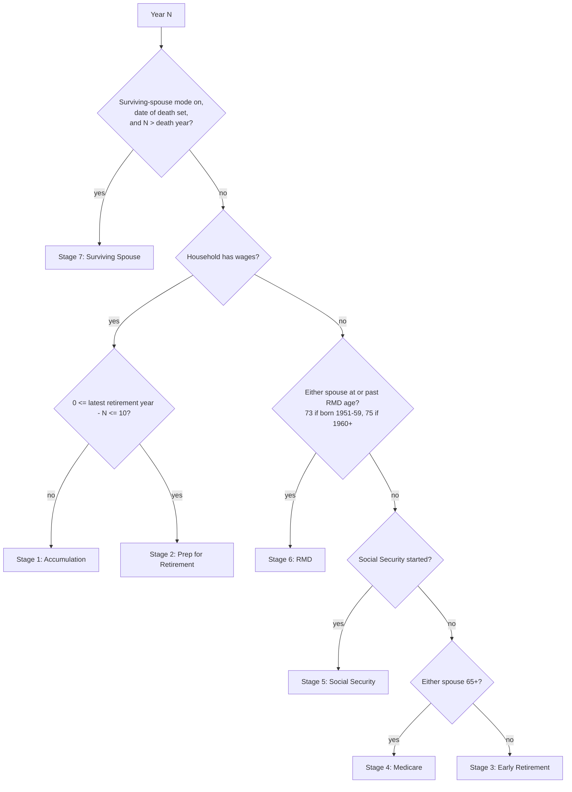
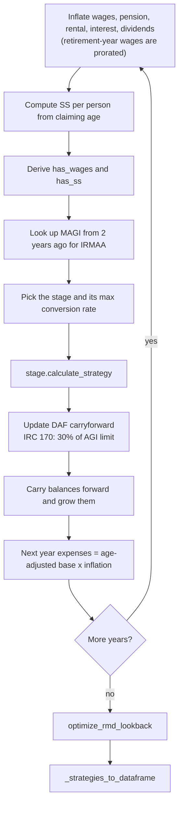
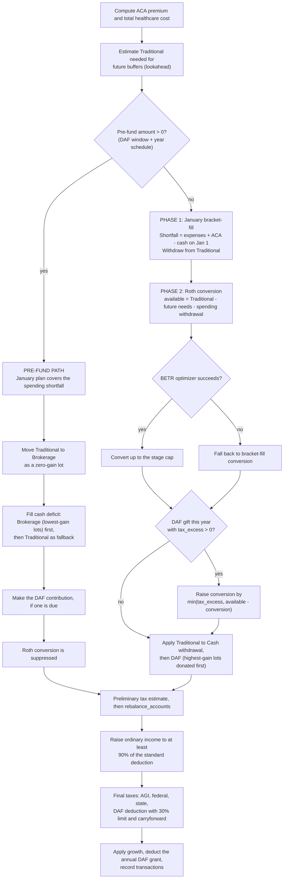
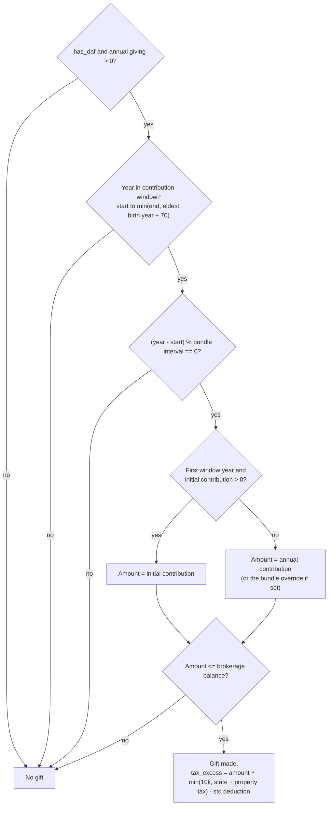
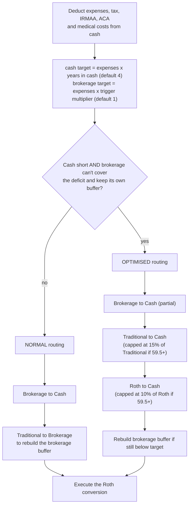

# Strategy Model Decision Tree

How the withdrawal strategy engine decides what to do each year. Source of truth:
[`strategy.py`](../strategy.py) (`WithdrawalStrategyEngine`) and
[`strategy_core/stages/`](../strategy_core/stages).

Stages 3 and 4 were read in detail. For Stages 1, 2, 5 and 7 only the main decisions and log
labels were reviewed, so treat their rows in section 6 as a summary.

## 1. Which stage applies in a given year

Stages are tested in the order 7, 1, 2, 3, 4, 5, 6. The first whose `applies()` returns True wins;
Stage 6 is the default.

Stage 1 also applies when no retirement year is configured.

## 2. What the engine does each year

Loop: `calculate_multi_year_strategy` in [`strategy.py`](../strategy.py).

`optimize_rmd_lookback` runs once after all years. If Stage 6 RMDs would exceed expenses it adds
extra Roth conversions in the earlier pre-RMD years.

## 3. Inside Stage 3

`Stage3EarlyRetirement.calculate_strategy` in
[`stage3_early_retirement.py`](../strategy_core/stages/stage3_early_retirement.py). Stages 4 and 5
follow the same shape.

The **pre-fund amount** is the sum of two sources, capped at Traditional minus reserved buffer needs:

1. **DAF window** — `charitable_giving.daf_trad_prefund_enabled/amount/start_year/end_year`.
2. **Year schedule** — `tax_strategy.trad_prefund_schedule`, a list of `{year, amount}` rows. It needs
   no DAF and is the place to seed a Direct Indexing portfolio.

The pre-fund path is only taken in **Stage 3** years. In a Stage 4+ year the pre-fund settings are ignored.

## 4. When a DAF gift happens

`_calculate_daf_for_year` in [`strategy.py`](../strategy.py).

Default bundle interval: `max(2, min(floor(std_ded / annual_giving) + 1, 5))` years.
`tax_strategy.daf_bundle_interval_years` overrides it.

## 5. How cash gets refilled

`rebalance_accounts` in [`strategy.py`](../strategy.py).

## 6. How the other stages differ

| Stage | What drives it |
|---|---|
| 1 Accumulation | Contribution routing and an accumulation Roth conversion. |
| 2 Prep | Roth 401k vs Traditional 401k, Cash→Roth contributions, backdoor vs direct Roth IRA, a BETR conversion, and DAF under the §170 30% limit. |
| 3 Early Retirement | Section 3: the pre-fund path or the normal January plan, then a BETR conversion with a DAF boost. |
| 4 Medicare | Same shape as Stage 3, but the conversion is IRMAA-aware (`irmaa_headroom`) and the DAF boost is capped by that headroom. |
| 5 Social Security | January spending, SS income, an IRMAA assessment, a Roth conversion with an RMD outlook, and the DAF boost. |
| 6 RMD | RMDs computed per person and sent to Brokerage first. Withdrawal need = expenses + healthcare − SS − RMD. LTCG harvesting up to the 15% bracket, and an RMD-limited conversion of `min(conversion_room, irmaa_headroom, traditional − rmd)`. IRMAA uses MAGI from two years earlier. |
| 7 Surviving Spouse | Single-filer brackets and survivor benefits, conservative LTCG harvesting up to the 15% bracket, and the same RMD, DAF, IRMAA and Roth pieces. |

## 7. Configuration that controls the tree

| Setting | Where (web app) | Effect |
|---|---|---|
| `tax_strategy.stage_N_max_conversion_rate` | Settings → Tax Strategy | Bracket ceiling for the Roth conversion in stage N. |
| `tax_strategy.use_january_bracket_fill_strategy`, `savings_safety_reserve` | Settings → Tax Strategy | January plan and the cash floor for mid-year top-ups. |
| `tax_strategy.trad_prefund_schedule` | Settings → Tax Strategy → "Traditional → Brokerage pre-fund by year" | `{year, amount}` rows. Moves $amount Traditional → Brokerage in that Stage 3 year (e.g. to seed Direct Indexing). Suppresses that year's Roth conversion. |
| `charitable_giving.daf_trad_prefund_*` | Settings → Charitable Giving | Same pre-fund path, over a start–end window, to fund DAF gifts. Adds to the schedule. |
| `charitable_giving.daf_*` | Settings → Charitable Giving | DAF gift window, initial/bundled amounts. |
| `financial_assumptions.years_of_expenses_in_cash`, `brokerage_rebalance_trigger_multiplier` | Settings → Financial Assumptions | Cash and brokerage buffer targets used by `rebalance_accounts`. |

### Troubleshooting: "pre-fund never fires"

1. **Check which config file the app reads.** The containers read `/data/retirement_config.json`
   (the `retirement_data` volume), *not* the copy in the project folder. Editing the project-folder
   file has no effect on the running app. Use Settings in the web app, or the Streamlit
   Configuration page.
2. The year must be a **Stage 3** year (no wages, no SS, both spouses under 65).
3. The amount is capped at `Traditional − anticipated buffer needs`; a log line "DAF pre-fund
   skipped — insufficient Traditional balance" means that cap hit zero.
4. Open Strategy → Why these numbers? for the year: a "Traditional → Brokerage Pre-Fund" reason
   appears when it fires, and "Roth Conversion Suppressed" follows it.
